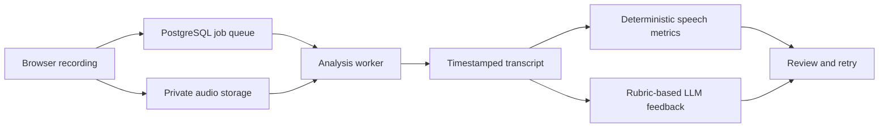

# Tanmay Kukreja

I’m an ML engineer in Bangalore. I like the part where a model has to fit on the hardware you actually have, handle messy data, and earn its place in someone’s workflow.

## Start here

**[Oratry](https://github.com/tanmaykay/Oratry)** is a speaking practice app that turns recordings into feedback you can use on your next attempt. A PostgreSQL-backed worker handles transcription and analysis. The app calculates speaking rate and filler counts directly from the transcript, then uses an LLM for rubric-based coaching. Raw recordings have a configurable retention window.

**[Charge Curve Simulation](https://github.com/tanmaykay/Charge-Curve-Simulation)** is a configurable synthetic EV charging generator. It simulates stepped current requests, thermal throttling, and charger dropouts, and exports time-series data and session metadata to Parquet.

## What I’m working on

- **EV charging models.** Exploring CVAEs, TCNs, and Transformers for charging-curve generation using 10,000+ real sessions. I’m testing quantization against a sub-300 KB target for in-vehicle hardware.
- **On-prem LLM serving.** Working with quantized Qwen2.5-14B on four V100 GPUs, served through vLLM behind a guardrails proxy. The platform is used by 100+ people.
- **Multimodal retrieval.** Working on RAG over a 2 TB enterprise document corpus, using Ragas to evaluate retrieval quality and answer accuracy.

## Selected work

- **Vehicle telemetry.** Worked on PySpark and Azure Data Explorer pipelines for millisecond-level telemetry from 2,000+ vehicles. The data feeds 24 Grafana dashboards used by 200+ engineers.
- **RFP review and drafting.** Worked on a LangGraph, Gemini, and FAISS workflow that brought first-pass review and response drafting for 50–600 page RFPs from weeks to about an hour.
- **Industrial vision.** Worked on circuit-schematic detection and reasoning at Hitachi, with reported results of 80.91% mAP50 for detection and 87.38% average reasoning accuracy.

Most of the enterprise work is private.

## Tech stack

| Area | Tools and technologies |
| --- | --- |
| ML and time series | Python, PyTorch, Hugging Face Transformers, NumPy, pandas, CVAEs, TCNs |
| Inference and deployment | vLLM, SGLang, AirLLM, llm-d, LiteLLM, LMCache, Kubernetes, ONNX, bitsandbytes, Qwen2.5, llama.rn |
| Fine-tuning and experiment tracking | PEFT, LoRA, QLoRA, TRL, Unsloth, MLflow, Weights & Biases |
| Retrieval, agents, and evaluation | FAISS, Milvus, Ragas, LangChain, LangGraph, Gemini, lm-evaluation-harness, DeepEval |
| Computer vision and multimodal models | YOLOv8, LLaVA, InternVL2 |
| Data engineering | PySpark, KQL, Azure Data Explorer, Azure Synapse, PyArrow, Parquet |
| Observability | Prometheus, Grafana, OpenTelemetry |
| APIs, storage, and infrastructure | FastAPI, PostgreSQL, Redis, Alembic, Docker Compose, Cloudflare R2, Deepgram |
| Web and mobile | TypeScript, React, Next.js, React Native |

**Serving optimization.** Continuous batching, prefix caching, KV-cache tuning, KV-aware routing, prefill/decode disaggregation, and speculative decoding.

**Agent tooling.** Harness engineering and custom Model Context Protocol (MCP) development.

## Research and contact

I co-authored [Accessing the Efficiency of Machine Learning Models for Crop Categorization Based on Regional Attributes in India](https://doi.org/10.1016/j.procs.2025.04.517), published in *Procedia Computer Science* in 2025.

I’m open to ML engineering, applied AI, and data science roles where I can take models from evaluation to deployment. Reach me by [email](mailto:writetotanmay@gmail.com) or on [LinkedIn](https://www.linkedin.com/in/tanmaykukreja).
